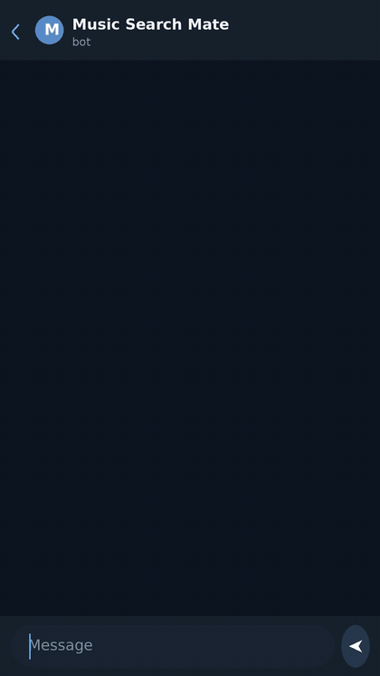

# Music Search Mate

<p align="center"></p>

[](LICENSE)
[](https://github.com/vonavikon/music-search-mate/actions/workflows/tests.yml)
[](https://www.virustotal.com/gui/file/61c789f0735b0a6d59184576371bf35c2008aef816a0775b528ef53e3ed7459f)

[Русский](README.ru.md) · [English](README.md) · [中文](README.zh.md) · **Español** · [Français](README.fr.md)

Un bot de Telegram que encuentra música a partir de una descripción libre: "AC/DC, pero algo más moderno, y en alemán", "la canción de la persecución en taxi con el Mercedes", "parecido a Moody Blues, Nights in White Satin". También descarga audio y vídeo por enlace, hasta 2 GB por archivo a través de un servidor local autoalojado de la Bot API. Hay una instancia en vivo funcionando: [@music_search_mate_bot](https://t.me/music_search_mate_bot).

<p align="center"></p>
Vídeo con calidad completa: [demo.mp4](assets/demo.mp4)

## Cómo funciona

El pipeline completo, de la descripción libre al archivo descargado (el esquema se mantiene en inglés):

```text
[user description]      free-form text, any language
        ↓
[LLM #1: extract]       intent (this_track / similar / from_source) + search queries;
                        destructive requests (drugs, weapons, violence, self-harm,
                        extremism) are cut here and by a regex prefilter before the LLM
        ↓
[youtube search]        yt-dlp runs the queries in parallel, ~20 raw candidates
        ↓
[filter + enrich]       dedup and cleanup; Last.fm tags, iTunes metadata and album artwork
        ↓
[LLM #2: rank]          picks the best candidate, sets confidence; not confident enough
                        → asks a clarifying question instead of downloading
        ↓
[track card]            top-1 with artwork and artist bio, "hit / miss" buttons
        ↓
[download]              audio as a tagged file with embedded artwork; video in background
```

- **Búsquedas de similares.** El tema de referencia se resuelve mediante Last.fm `track.search` hasta llegar a un artista canónico, sus vecinos (`getSimilar`) se inyectan en las consultas de búsqueda y la propia referencia queda vetada en los resultados.
- **Bucle de feedback.** Un toque en "miss" recuerda el candidato rechazado y ofrece el siguiente; la búsqueda posterior excluye lo que ya habías descartado.
- **Moderación que resiste trucos.** El texto de la petición se normaliza antes de cualquier comprobación: NFKC más plegado en ambas direcciones de los homóglifos parecidos del latín y del cirílico, de modo que las grafías ofuscadas y las inyecciones de prompt no se cuelan.

## Características

- **Búsqueda por descripción:** un tema concreto, "algo parecido a X" o "aquella canción de la película/juego/anuncio"; el LLM elige la intención y reescribe la consulta para la búsqueda.
- **Descargas por enlace:** audio o vídeo desde una lista de hosts permitidos (YouTube, SoundCloud, Bandcamp, VK; la lista existe porque una URL abierta convertiría el contenedor en un proxy SSRF). La calidad del vídeo se elige con botones, de 480p a 1440p, a través de una cascada de códecs desde el mp4 nativo hasta un fallback por fusión de flujos.
- **Archivos de 2 GB:** las subidas pasan por un servidor local autoalojado de la Bot API; sin él, la API en la nube estándar de Telegram limita los archivos a 50 MB.
- **Audio etiquetado:** se envía como archivo con etiquetas canónicas de artista/título/álbum y la portada del álbum incrustada (la de iTunes cuando está disponible, la miniatura del vídeo como fallback). La ruta de descarga prefiere el AAC nativo en m4a, hace remux sin recodificar cuando es posible y recurre a mp3 320k.
- **Tarjeta del tema:** portada, artista canónico, bio breve, botones "hit / miss".
- **Datos del tema:** el botón 💡 obtiene un dato sobre el tema basado en búsquedas web vía Perplexity sonar, en caché durante 30 días; los toques repetidos no consumen cuota.
- **Cachés:** file_id de Telegram (un tema enviado antes se reenvía sin descargarlo de nuevo), caché de datos, pools de similares, consultas a Last.fm con TTL.
- **Grupos:** el bot reacciona solo a las @menciones (modo de privacidad desactivado más un filtro explícito en el código); los límites por usuario se aplican en todas partes.
- **Localización:** RU/EN para errores, estados, botones y las preguntas aclaratorias que hace el LLM; se cambia con /lang.
- **Límites, en número de peticiones y no en gigabytes:** 20 peticiones por hora por usuario, 100 búsquedas al día en la instancia en vivo (200 por defecto en el código, se ajusta por env) y 30 vídeos al día, 2 datos al día (los aciertos de caché no consumen cuota), más presupuestos diarios globales para todos.
- **Progreso honesto:** una barra de progreso en porcentaje (se actualiza aproximadamente cada 3% / 1.2 s) y una etapa aparte de "preparing file" mientras el archivo se convierte, se etiqueta y se sube.
- **Observabilidad:** un embudo en SQLite con los resultados de las peticiones (ok / clarify / empty / blocked / limit / error) y trazas opcionales con Langfuse de cada etapa del pipeline; sin claves, las trazas permanecen desactivadas.

## Instalación desde el código fuente

Necesitas Python 3.12+ y un token de bot de @BotFather. El bot no se publica como paquete; solo se ejecuta desde el código fuente. Todas las llamadas al LLM pasan por tu propia pasarela compatible con OpenAI con tu propia clave, y las capas opcionales (Last.fm, Langfuse) también usan tus claves.

```bash
python -m venv .venv
.venv/bin/pip install -r requirements.txt
cp .env.example .env
# edit .env, then start (the same command the Docker image runs):
.venv/bin/python -m bot.main
```

Claves en `.env`:

- `BOT_TOKEN`: token de @BotFather. Obligatorio.
- `BOTHUB_API_KEY` + `BOTHUB_BASE`: cualquier pasarela compatible con OpenAI. Un modelo extrae y clasifica (`LLM_MODEL`), otro genera los datos basados en búsquedas web (`LLM_MODEL_SONAR`, vacío desactiva la capa de datos).
- `LASTFM_API_KEY`: opcional; sin ella, la capa de Last.fm se omite sin errores.
- `LANGFUSE_PUBLIC_KEY` / `LANGFUSE_SECRET_KEY` / `LANGFUSE_HOST`: trazas opcionales; sin claves, las trazas están desactivadas.
- `TG_API_ID` / `TG_API_HASH` / `LOCAL_BOT_API_URL`: servidor local de la Bot API opcional para archivos de hasta 2 GB (tus propias credenciales de aplicación de my.telegram.org). Sin él se aplica el límite de 50 MB de la nube. Al pasar un bot al servidor local por primera vez, llama a `logOut` contra api.telegram.org una sola vez, o las actualizaciones seguirán llegando a la nube.

Pruebas: 301 pruebas, todas offline contra mocks, sin necesidad de red.

```bash
.venv/bin/python -m pytest -q
```

También existe un smoke gate con red real (`make smoke`, ~2 minutos) que llama a la pasarela real y a yt-dlp; para desarrollar basta con la suite offline.

### Docker

```bash
docker compose -f docker-compose.public.yml up -d
```

La imagen se construye desde este repositorio: Python 3.12-slim, ffmpeg, deno (un runtime de JS que yt-dlp necesita para el n-challenge de YouTube) y el build nightly de yt-dlp en lugar del estable fijado.

## Arquitectura

```text
bot/
  main.py                     entrypoint (python -m bot.main): handlers, rate limiter,
                              local Bot API wiring, error handler
  handler.py                  message flow: search pipeline, URL fast path,
                              feedback / similar / clarify / download callbacks
services/
  llm_search.py               LLM #1 (extract) and LLM #2 (rank), moderation block,
                              similar-reference resolve via Last.fm
  search.py                   yt-dlp metadata search without downloading
                              (YouTube first, SoundCloud as fallback)
  media.py                    audio/video download via yt-dlp subprocess, live progress,
                              temp TTL cleanup, circuit breaker
  metadata.py                 metadata cascade: yt-dlp info dict → Last.fm → iTunes artwork
  tag_enrichment.py           writes canonical tags and artwork into the file (ffmpeg)
  match_score.py              deterministic rule-based match score that guards auto-download
  store.py                    SQLite (aiosqlite): queries, feedback, usage limits, caches
  observability.py            circuit breaker for upstreams, PII redaction in logs
  tracing.py                  optional Langfuse tracing, one trace per search
config.py                     env config: models, limits, allowlists, retention
tests/                        301 tests, offline mocks, pytest
```

## Estado

Un proyecto personal con un solo mantenedor. Versión 1.17 (noviembre de 2026); la instancia pública ejecuta este código.

El proyecto creció del uso real, no de una hoja de ruta: las variantes subidas ralentizadas y aceleradas rompían las etiquetas y las portadas hasta que el filtro de candidatos aprendió a descartarlas; el modo de grupos se rehizo tras las quejas de grupos reales; el servidor local de la Bot API apareció cuando el techo de 50 MB de la nube se convirtió en el límite real.

Limitaciones, con honestidad: la calidad de la búsqueda depende de lo bien que el LLM te entienda, y cuando no está seguro preguntará en lugar de adivinar; yt-dlp vive de los detalles internos de YouTube, así que cuando YouTube cambia algo, las descargas pueden romperse hasta que el build nightly se pone al día; necesitas tus propias claves de API para la pasarela del LLM (también para Last.fm, si quieres la capa de metadatos); y el ritmo de los arreglos es el de una sola persona.

## Licencia

MIT, consulta [LICENSE](LICENSE).
