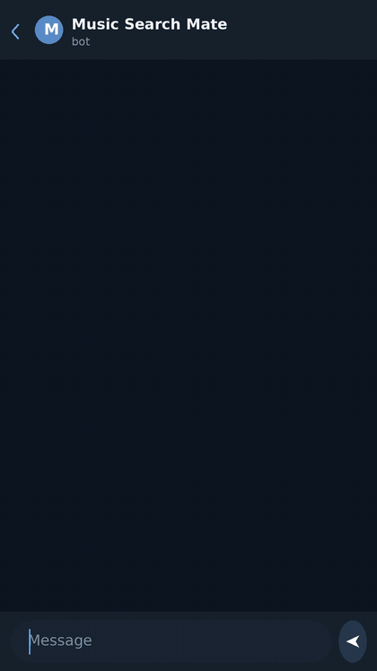

# Music Search Mate

<p align="center"></p>

[](LICENSE)
[](https://github.com/vonavikon/music-search-mate/actions/workflows/tests.yml)
<!-- VT badge after pre-release scan -->

[Русский](README.ru.md) · [English](README.md) · [中文](README.zh.md) · [Español](README.es.md) · **Français**

Un bot Telegram qui trouve de la musique à partir d'une description libre: « dans le style d'AC/DC, mais plus récent, et en allemand », « la chanson de la poursuite en taxi avec la Mercedes », « quelque chose comme Moody Blues, Nights in White Satin ». Il télécharge aussi l'audio et la vidéo depuis un lien, jusqu'à 2 Go par fichier via un serveur Bot API local auto-hébergé. Une instance est en ligne: [@music_search_mate_bot](https://t.me/music_search_mate_bot).

<p align="center"></p>
Vidéo en pleine qualité: [demo.mp4](assets/demo.mp4)

## Comment ça marche

Le schéma du pipeline ci-dessous est laissé en anglais pour préserver l'alignement des flèches.

```text
[user description]      free-form text, any language
        ↓
[LLM #1: extract]       intent (this_track / similar / from_source) + search queries;
                        destructive requests (drugs, weapons, violence, self-harm,
                        extremism) are cut here and by a regex prefilter before the LLM
        ↓
[youtube search]        yt-dlp runs the queries in parallel, ~20 raw candidates
        ↓
[filter + enrich]       dedup and cleanup; Last.fm tags, iTunes metadata and album artwork
        ↓
[LLM #2: rank]          picks the best candidate, sets confidence; not confident enough
                        → asks a clarifying question instead of downloading
        ↓
[track card]            top-1 with artwork and artist bio, "hit / miss" buttons
        ↓
[download]              audio as a tagged file with embedded artwork; video in background
```

- **Recherche de morceaux similaires.** Le morceau de référence est résolu via `track.search` de Last.fm en un artiste canonique, ses voisins (`getSimilar`) sont injectés dans les requêtes de recherche, et la référence elle-même est bannie des résultats.
- **Boucle de retour.** Un appui sur « miss » (raté) mémorise le candidat rejeté et propose le suivant; la recherche suivante exclut ce que vous avez déjà écarté.
- **Une modération qui résiste aux astuces.** Le texte de la requête est normalisé avant toute vérification: NFKC plus repliement des homoglyphes latins et cyrilliques ressemblants, dans les deux sens, si bien que les orthographes obfusquées et les injections de prompt ne passent pas.

## Fonctionnalités

- **Recherche par description:** un morceau précis, « quelque chose comme X » ou « cette chanson du film/du jeu/de la pub»; le LLM détermine l'intention et reformule la requête pour la recherche.
- **Téléchargements par lien:** audio ou vidéo depuis une liste d'hôtes autorisés (YouTube, SoundCloud, Bandcamp, VK; cette liste existe parce qu'une URL libre transformerait le conteneur en proxy SSRF). La qualité vidéo se choisit via des boutons, de 480p à 1440p, à travers une cascade de codecs du mp4 natif jusqu'à un repli par fusion des flux.
- **Fichiers de 2 Go:** les envois passent par un serveur Bot API local auto-hébergé; sans lui, l'API cloud standard de Telegram plafonne les fichiers à 50 Mo.
- **Audio avec tags:** envoyé sous forme de fichier avec des tags canoniques artiste/titre/album et la pochette intégrée (pochette iTunes quand elle existe, miniature de la vidéo en repli). Le chemin de téléchargement privilégie l'AAC natif en m4a, remuxe sans réencodage quand c'est possible, et se replie sur du mp3 320k.
- **Fiche du morceau:** pochette, artiste canonique, courte bio, boutons « hit / miss » (trouvé / raté).
- **Faits sur le morceau:** le bouton 💡 va chercher un fait sur le morceau, ancré dans le web, via Perplexity sonar, mis en cache pour 30 jours; les appuis répétés sont gratuits.
- **Caches:** file_id Telegram (un morceau déjà envoyé est renvoyé sans retéléchargement), cache des faits, pools de morceaux similaires, consultations Last.fm avec TTL.
- **Groupes:** le bot ne réagit qu'aux @mentions (mode confidentialité désactivé plus un garde-fou explicite dans le code); les limites par utilisateur s'appliquent partout.
- **Localisation:** RU/EN pour les erreurs, les statuts, les boutons et les questions de clarification posées par le LLM; on bascule avec /lang.
- **Limites, en unités plutôt qu'en gigaoctets:** 20 requêtes par heure et par utilisateur, 100 recherches par jour sur l'instance en ligne (200 par défaut dans le code, réglable par env) et 30 vidéos par jour, 2 faits par jour (les accès en cache sont gratuits), plus des budgets journaliers globaux pour tout le monde.
- **Progression honnête:** une barre de progression en pourcentage (mise à jour environ tous les 3 % / 1,2 s) et une étape distincte « préparation du fichier » pendant que le fichier est converti, tagué et envoyé.
- **Observabilité:** un funnel SQLite de l'issue des requêtes (ok / clarify / empty / blocked / limit / error) et un traçage Langfuse optionnel de chaque étape du pipeline; sans les clés, le traçage reste désactivé.

## Installation depuis les sources

Il vous faut Python 3.12+ et un token de bot obtenu auprès de @BotFather. Le bot n'est pas publié comme paquet; il se lance uniquement depuis les sources. Tous les appels LLM passent par votre propre passerelle compatible OpenAI avec votre propre clé, et les couches optionnelles (Last.fm, Langfuse) utilisent elles aussi vos clés.

```bash
python -m venv .venv
.venv/bin/pip install -r requirements.txt
cp .env.example .env
# edit .env, then start (the same command the Docker image runs):
.venv/bin/python -m bot.main
```

Clés dans `.env`:

- `BOT_TOKEN`: token de @BotFather. Obligatoire.
- `BOTHUB_API_KEY` + `BOTHUB_BASE`: n'importe quelle passerelle compatible OpenAI. Un modèle fait l'extraction et le classement (`LLM_MODEL`), un autre s'occupe des faits ancrés dans le web (`LLM_MODEL_SONAR`, une valeur vide désactive la couche de faits).
- `LASTFM_API_KEY`: optionnel; sans lui, la couche Last.fm est simplement ignorée.
- `LANGFUSE_PUBLIC_KEY` / `LANGFUSE_SECRET_KEY` / `LANGFUSE_HOST`: traçage optionnel; sans les clés, le traçage est désactivé.
- `TG_API_ID` / `TG_API_HASH` / `LOCAL_BOT_API_URL`: serveur Bot API local optionnel pour des fichiers jusqu'à 2 Go (vos propres identifiants d'application depuis my.telegram.org). Sans lui, la limite cloud de 50 Mo s'applique. Lors du premier passage d'un bot au serveur local, appelez `logOut` une fois contre api.telegram.org, sinon les updates continuent de partir vers le cloud.

Tests: 301 tests, tous hors ligne sur des mocks, sans réseau nécessaire.

```bash
.venv/bin/python -m pytest -q
```

Il existe aussi un test smoke sur réseau réel (`make smoke`, ~2 minutes) qui sollicite la passerelle et yt-dlp pour de vrai; la suite hors ligne suffit pour développer.

### Docker

```bash
docker compose -f docker-compose.public.yml up -d
```

L'image est construite depuis ce dépôt: Python 3.12-slim, ffmpeg, deno (un runtime JS dont yt-dlp a besoin pour le n-challenge de YouTube), et le build nightly de yt-dlp à la place de la version stable épinglée.

## Architecture

```text
bot/
  main.py                     entrypoint (python -m bot.main): handlers, rate limiter,
                              local Bot API wiring, error handler
  handler.py                  message flow: search pipeline, URL fast path,
                              feedback / similar / clarify / download callbacks
services/
  llm_search.py               LLM #1 (extract) and LLM #2 (rank), moderation block,
                              similar-reference resolve via Last.fm
  search.py                   yt-dlp metadata search without downloading
                              (YouTube first, SoundCloud as fallback)
  media.py                    audio/video download via yt-dlp subprocess, live progress,
                              temp TTL cleanup, circuit breaker
  metadata.py                 metadata cascade: yt-dlp info dict → Last.fm → iTunes artwork
  tag_enrichment.py           writes canonical tags and artwork into the file (ffmpeg)
  match_score.py              deterministic rule-based match score that guards auto-download
  store.py                    SQLite (aiosqlite): queries, feedback, usage limits, caches
  observability.py            circuit breaker for upstreams, PII redaction in logs
  tracing.py                  optional Langfuse tracing, one trace per search
config.py                     env config: models, limits, allowlists, retention
tests/                        301 tests, offline mocks, pytest
```

## Statut

Un projet personnel avec un seul mainteneur. Version 1.17 (novembre 2026); l'instance publique exécute ce code.

Le projet a grandi à partir d'un usage réel, pas d'une feuille de route: les variantes ralenties et accélérées des morceaux cassaient les tags et les pochettes jusqu'à ce que le filtre de candidats apprenne à les écarter; le mode groupes a été refait après des plaintes venant de vrais chats de groupe; le serveur Bot API local est apparu quand le plafond cloud de 50 Mo est devenu la limite réelle.

Les limites, sans détour: la qualité de recherche dépend de la façon dont le LLM vous comprend, et quand il doute, il pose une question de clarification au lieu de deviner; yt-dlp repose sur les rouages internes de YouTube, donc quand YouTube change quelque chose, les téléchargements peuvent casser jusqu'à ce que le build nightly rattrape; il vous faut vos propres clés API pour la passerelle LLM (Last.fm aussi, si vous voulez la couche de métadonnées); et le rythme des correctifs est celui d'une seule personne.

## Licence

MIT, voir [LICENSE](LICENSE).
