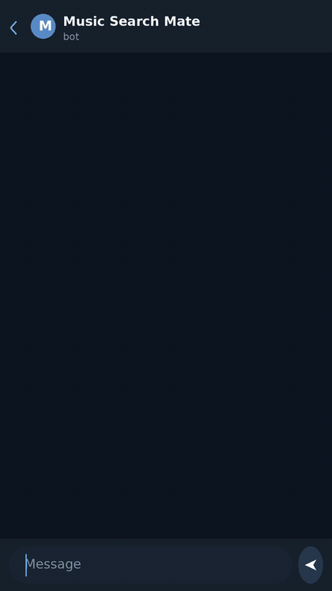

# Music Search Mate

<p align="center"></p>

[](LICENSE)
[](https://github.com/vonavikon/music-search-mate/actions/workflows/tests.yml)
[](https://www.virustotal.com/gui/file/61c789f0735b0a6d59184576371bf35c2008aef816a0775b528ef53e3ed7459f)

[Русский](README.ru.md) · **English** · [中文](README.zh.md) · [Español](README.es.md) · [Français](README.fr.md)

A Telegram bot that finds music from a free-form description: "AC/DC, but something more modern, and in German", "the song from the taxi chase with the Mercedes", "similar to Moody Blues, Nights in White Satin". It also downloads audio and video by link, up to 2 GB per file through a self-hosted local Bot API server. A live instance is running: [@music_search_mate_bot](https://t.me/music_search_mate_bot).

<p align="center"></p>
Full quality video: [demo.mp4](assets/demo.mp4)

## How it works

```text
[user description]      free-form text, any language
        ↓
[LLM #1: extract]       intent (this_track / similar / from_source) + search queries;
                        destructive requests (drugs, weapons, violence, self-harm,
                        extremism) are cut here and by a regex prefilter before the LLM
        ↓
[youtube search]        yt-dlp runs the queries in parallel, ~20 raw candidates
        ↓
[filter + enrich]       dedup and cleanup; Last.fm tags, iTunes metadata and album artwork
        ↓
[LLM #2: rank]          picks the best candidate, sets confidence; not confident enough
                        → asks a clarifying question instead of downloading
        ↓
[track card]            top-1 with artwork and artist bio, "hit / miss" buttons
        ↓
[download]              audio as a tagged file with embedded artwork; video in background
```

- **Similar searches.** The reference track is resolved through Last.fm `track.search` into a canonical artist, its neighbors (`getSimilar`) are injected into the search queries, and the reference itself is banned from the results.
- **Feedback loop.** A "miss" tap remembers the rejected candidate and offers the next one; the follow-up search excludes what you already turned down.
- **Moderation that survives tricks.** The request text is normalized before any check: NFKC plus folding of Latin and Cyrillic homoglyph lookalikes in both directions, so obfuscated spellings and prompt injections do not slip through.

## Features

- **Search by description:** a concrete track, "something similar to X", or "that song from the movie/game/ad"; the LLM picks the intent and rewrites the query for search.
- **Downloads by link:** audio or video from an allowlist of hosts (YouTube, SoundCloud, Bandcamp, VK; the allowlist exists because an open URL would turn the container into an SSRF proxy). Video quality is picked with buttons, 480p to 1440p, through a codec cascade from native mp4 to a merged fallback.
- **2 GB files:** uploads go through a self-hosted local Bot API server; without it the standard Telegram cloud API caps files at 50 MB.
- **Tagged audio:** sent as a file with canonical artist/title/album tags and embedded album artwork (iTunes artwork when available, video thumbnail as fallback). The download path prefers native AAC in m4a, remuxes without re-encoding when possible, falls back to mp3 320k.
- **Track card:** artwork, canonical artist, short bio, "hit / miss" buttons.
- **Track facts:** the 💡 button fetches one web-grounded fact about the track via Perplexity sonar, cached for 30 days; repeated taps are free.
- **Caches:** Telegram file_id (a track sent before is re-sent without downloading again), fact cache, similar pools, Last.fm lookups with a TTL.
- **Groups:** the bot reacts only to @mentions (privacy mode off plus an explicit gate in code); per-user limits apply everywhere.
- **Localization:** RU/EN for errors, statuses, buttons, and the clarifying questions the LLM asks; switch with /lang.
- **Limits, in pieces not gigabytes:** 20 requests per hour per user, 100 searches a day on the live instance (code default 200, set by env) and 30 videos per day, 2 facts per day (cache hits are free), plus global daily budgets for everyone.
- **Honest progress:** a percent progress bar (updates roughly every 3% / 1.2 s) and a separate "preparing file" stage while the file is converted, tagged, and uploaded.
- **Observability:** a SQLite funnel of request outcomes (ok / clarify / empty / blocked / limit / error) and optional Langfuse tracing of every pipeline stage; tracing stays off without keys.

## Installing from source

You need Python 3.12+ and a bot token from @BotFather. The bot is not published as a package; source runs only. All LLM calls go through your own OpenAI-compatible gateway with your own key, and optional layers (Last.fm, Langfuse) use your keys too.

```bash
python -m venv .venv
.venv/bin/pip install -r requirements.txt
cp .env.example .env
# edit .env, then start (the same command the Docker image runs):
.venv/bin/python -m bot.main
```

Keys in `.env`:

- `BOT_TOKEN`: token from @BotFather. Required.
- `BOTHUB_API_KEY` + `BOTHUB_BASE`: any OpenAI-compatible gateway. One model extracts and ranks (`LLM_MODEL`), another does web-grounded facts (`LLM_MODEL_SONAR`, empty disables the fact layer).
- `LASTFM_API_KEY`: optional; without it the Last.fm layer is skipped gracefully.
- `LANGFUSE_PUBLIC_KEY` / `LANGFUSE_SECRET_KEY` / `LANGFUSE_HOST`: optional tracing; without keys tracing is off.
- `TG_API_ID` / `TG_API_HASH` / `LOCAL_BOT_API_URL`: optional local Bot API server for files up to 2 GB (your own app credentials from my.telegram.org). Without it the 50 MB cloud limit applies. When switching a bot to the local server for the first time, call `logOut` against api.telegram.org once, or updates keep going to the cloud.

Tests: 301 tests, all offline against mocks, no network needed.

```bash
.venv/bin/python -m pytest -q
```

There is also a real-network smoke gate (`make smoke`, ~2 minutes) that hits the actual gateway and yt-dlp; the offline suite is enough for development.

### Docker

```bash
docker compose -f docker-compose.public.yml up -d
```

The image is built from this repository: Python 3.12-slim, ffmpeg, deno (a JS runtime yt-dlp needs for YouTube's n-challenge), and the nightly yt-dlp build over the pinned stable one.

## Architecture

```text
bot/
  main.py                     entrypoint (python -m bot.main): handlers, rate limiter,
                              local Bot API wiring, error handler
  handler.py                  message flow: search pipeline, URL fast path,
                              feedback / similar / clarify / download callbacks
services/
  llm_search.py               LLM #1 (extract) and LLM #2 (rank), moderation block,
                              similar-reference resolve via Last.fm
  search.py                   yt-dlp metadata search without downloading
                              (YouTube first, SoundCloud as fallback)
  media.py                    audio/video download via yt-dlp subprocess, live progress,
                              temp TTL cleanup, circuit breaker
  metadata.py                 metadata cascade: yt-dlp info dict → Last.fm → iTunes artwork
  tag_enrichment.py           writes canonical tags and artwork into the file (ffmpeg)
  match_score.py              deterministic rule-based match score that guards auto-download
  store.py                    SQLite (aiosqlite): queries, feedback, usage limits, caches
  observability.py            circuit breaker for upstreams, PII redaction in logs
  tracing.py                  optional Langfuse tracing, one trace per search
config.py                     env config: models, limits, allowlists, retention
tests/                        301 tests, offline mocks, pytest
```

## Status

A pet project with one maintainer. Version 1.17 (November 2026); the public instance runs this code.

The project grew from real usage, not a roadmap: slowed-down and sped-up upload variants were breaking tags and artwork until the candidate filter learned to drop them; group mode was rebuilt after complaints from live group chats; the local Bot API server appeared when the 50 MB cloud ceiling became the actual limit.

Limitations, honestly: search quality depends on how well the LLM understands you, and when it is unsure it will ask back instead of guessing; yt-dlp lives on YouTube internals, so when YouTube changes something, downloads can break until the nightly build catches up; you need your own API keys for the LLM gateway (Last.fm too, if you want the metadata layer); and the pace of fixes is one person's.

## License

MIT, see [LICENSE](LICENSE).
