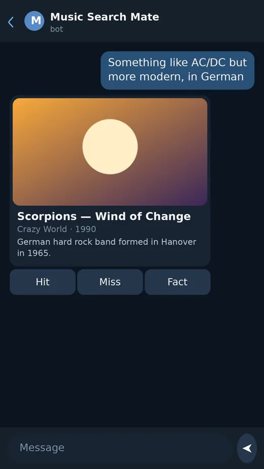

# Music Search Mate

[](LICENSE)
[](https://github.com/vonavikon/music-search-mate/actions/workflows/tests.yml)
<!-- VT badge after pre-release scan -->

**Русский** · [English](README.md) · [中文](README.zh.md) · [Español](README.es.md) · [Français](README.fr.md)

Telegram-бот, который находит музыку по свободному описанию: «AC/DC, но что-то поновее и на немецком», «песня из погони на такси с Мерседесом», «похоже на Moody Blues, Nights in White Satin». Плюс скачивание аудио и видео по ссылке, до 2 ГБ на файл через собственный local Bot API server. Живой инстанс: [@music_search_mate_bot](https://t.me/music_search_mate_bot).


Видеоверсия: [demo.mp4](assets/demo.mp4)

## Как это работает

```text
[описание пользователя]   свободный текст на любом языке
        ↓
[LLM #1: extract]         интент (this_track / similar / from_source) + поисковые фразы;
                          деструктивные запросы (наркотики, оружие, насилие,
                          селфхарм, экстремизм) режутся здесь и регекс-префильтром до LLM
        ↓
[поиск на youtube]        yt-dlp гонит фразы параллельно, ~20 сырых кандидатов
        ↓
[фильтр + enrich]         дедуп и чистка; теги Last.fm, метаданные и обложки iTunes
        ↓
[LLM #2: rank]            выбирает лучшего кандидата, выставляет confidence;
                          уверенности нет → уточняющий вопрос вместо скачивания
        ↓
[карточка трека]          топ-1 с обложкой и био артиста, кнопки «То / Не то»
        ↓
[скачивание]              аудио файлом с тегами и обложкой; видео в фоне
```

- **Похожее.** Референс резолвится через Last.fm `track.search` в канонического артиста, его соседи (`getSimilar`) инъектируются в поисковые фразы, а сам референс банится в выдаче.
- **Цикл фидбека.** Нажатие «Не то» запоминает отвергнутого кандидата и предлагает следующего; повторный поиск исключает то, что вы уже отклонили.
- **Модерация, устойчивая к трюкам.** Текст запроса нормализуется до любых проверок: NFKC плюс фолд латинских и кириллических гомоглифов-двойников в обе стороны, поэтому обфусцированные написания и промпт-инъекции не проходят.

## Возможности

- **Поиск по описанию:** конкретный трек, «что-то похожее на X» или «та песня из фильма/игры/рекламы»; LLM определяет интент и переформулирует запрос под поиск.
- **Скачивание по ссылке:** аудио или видео с сайтов из allowlist (YouTube, SoundCloud, Bandcamp, VK; allowlist нужен потому, что открытый URL превратил бы контейнер в SSRF-прокси). Качество видео выбирается кнопками, от 480p до 1440p, каскадом кодеков от нативного mp4 до merge-фолбэка.
- **Файлы до 2 ГБ:** аплоады идут через собственный local Bot API server; без него стандартное облако Telegram режет файлы на 50 МБ.
- **Тегированное аудио:** приходит файлом с каноничными тегами артист/название/альбом и вшитой альбомной обложкой (обложка iTunes, если есть, иначе thumbnail видео). Путь скачивания предпочитает нативный AAC в m4a, ремуксит без перекодировки, когда можно, фолбэк mp3 320k.
- **Карточка трека:** обложка, каноничный артист, короткое био, кнопки «То / Не то».
- **Факты о треке:** кнопка 💡 достаёт один факт о треке через Perplexity sonar с опорой на веб, кеш 30 дней; повторные нажатия бесплатны.
- **Кеши:** Telegram file_id (уже отправленный трек отсылается повторно без скачивания), кеш фактов, пулы похожего, Last.fm-запросы с TTL.
- **Группы:** бот реагирует только на @упоминания (privacy mode off плюс явный гейт в коде); лимиты на юзера действуют везде.
- **Локализация:** RU/EN для ошибок, статусов, кнопок и уточняющих вопросов LLM; переключение через /lang.
- **Лимиты, в штуках а не гигабайтах:** 20 запросов в час на юзера, 100 поисков в день на живом инстансе (кодовый дефолт 200, меняется env) и 30 видео в день, 2 факта в день (попадание в кеш бесплатно), плюс глобальные дневные бюджеты на всех.
- **Честный прогресс:** прогресс-бар в процентах (обновление примерно раз в 3% / 1.2 с) и отдельная стадия «preparing file», пока файл конвертируется, тегируется и отправляется.
- **Наблюдаемость:** SQLite-воронка исходов запросов (ok / clarify / empty / blocked / limit / error) и опциональный Langfuse-трейсинг каждого этапа пайплайна; без ключей трейсинг выключен.

## Установка из исходников

Нужны Python 3.12+ и токен бота от @BotFather. Бот не публикуется как пакет, только запуск из исходников. Все LLM-вызовы идут через ваш OpenAI-совместимый шлюз с вашим ключом; опциональные слои (Last.fm, Langfuse) тоже на ваших ключах.

```bash
python -m venv .venv
.venv/bin/pip install -r requirements.txt
cp .env.example .env
# отредактируйте .env, затем запуск (та же команда, что в Docker-образе):
.venv/bin/python -m bot.main
```

Ключи в `.env`:

- `BOT_TOKEN`: токен от @BotFather. Обязателен.
- `BOTHUB_API_KEY` + `BOTHUB_BASE`: любой OpenAI-совместимый шлюз. Одна модель делает extract и rank (`LLM_MODEL`), другая факты с опорой на веб (`LLM_MODEL_SONAR`, пусто = слой фактов выключен).
- `LASTFM_API_KEY`: опционален; без него слой Last.fm просто пропускается.
- `LANGFUSE_PUBLIC_KEY` / `LANGFUSE_SECRET_KEY` / `LANGFUSE_HOST`: опциональный трейсинг; без ключей выключен.
- `TG_API_ID` / `TG_API_HASH` / `LOCAL_BOT_API_URL`: опциональный local Bot API server для файлов до 2 ГБ (свои креды приложения с my.telegram.org). Без него действует ограничение облака в 50 МБ. При первом переключении бота на local server нужно один раз вызвать `logOut` против api.telegram.org, иначе апдейты продолжат уходить в облако.

Тесты: 301 тест, все офлайн на моках, сеть не нужна.

```bash
.venv/bin/python -m pytest -q
```

Есть ещё смоук-гейт на реальной сети (`make smoke`, ~2 минуты): живой шлюз и yt-dlp; для разработки достаточно офлайн-набора.

### Docker

```bash
docker compose -f docker-compose.public.yml up -d
```

Образ собирается из этого репозитория: Python 3.12-slim, ffmpeg, deno (JS-runtime, нужен yt-dlp для n-challenge YouTube) и nightly-сборка yt-dlp поверх закреплённой стабильной.

## Архитектура

```text
bot/
  main.py                     точка входа (python -m bot.main): хендлеры, rate limiter,
                              подключение local Bot API, error handler
  handler.py                  поток сообщений: пайплайн поиска, URL fast path,
                              колбэки фидбек / похожее / уточнение / скачивание
services/
  llm_search.py               LLM #1 (extract) и LLM #2 (rank), модерация,
                              резолв референса похожего через Last.fm
  search.py                   поиск метаданных через yt-dlp без скачивания
                              (YouTube приоритетен, SoundCloud фолбэк)
  media.py                    скачивание аудио/видео субпроцессом yt-dlp, живой прогресс,
                              TTL-очистка temp, circuit breaker
  metadata.py                 каскад метаданных: info dict yt-dlp → Last.fm → обложка iTunes
  tag_enrichment.py           запись каноничных тегов и обложки в файл (ffmpeg)
  match_score.py              детерминированный rule-based скор, охраняющий авто-выдачу
  store.py                    SQLite (aiosqlite): queries, feedback, лимиты, кеши
  observability.py            circuit breaker на апстримы, редакция PII в логах
  tracing.py                  опциональный Langfuse-трейсинг, один трейс на поиск
config.py                     конфиг из env: модели, лимиты, allowlist, retention
tests/                        301 тест, офлайн-моки, pytest
```

## Статус

Pet-проект с одним мейнтейнером. Версия 1.17 (ноябрь 2026); публичный инстанс работает на этом коде.

Проект вырос из реального использования, а не из роадмапа: slowed- и sped-up-версии загрузок ломали теги и обложки, пока фильтр кандидатов не научился их отбрасывать; групповой режим переделан после жалоб из живых групп; local Bot API server появился, когда потолок облака в 50 МБ стал реальным ограничением.

Ограничения, честно: качество поиска зависит от того, насколько LLM понимает вас, и при неуверенности бот спросит уточнение вместо того, чтобы угадывать; yt-dlp живёт на внутренностях YouTube, так что при их изменениях скачивание может ломаться, пока nightly-сборка не догонит; нужны свои ключи для LLM-шлюза (и для Last.fm, если нужен слой метаданных); темп исправлений, это темп одного человека.

## Лицензия

MIT, см. [LICENSE](LICENSE).
